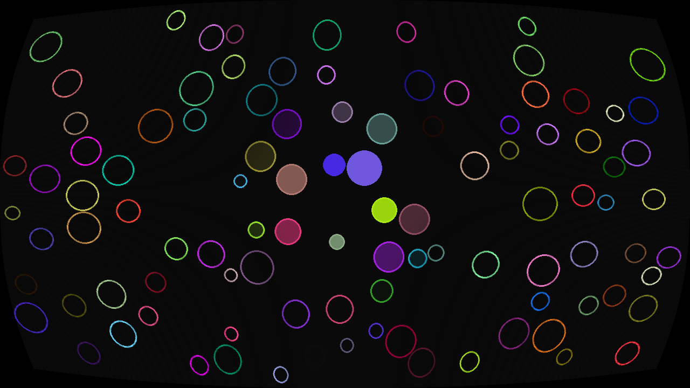

# Circle collisions

Moving circles with elastic collisions, cursor-driven fills, and a curved-screen
shader with scanlines.



## Run

Requires Python 3.10+ and OpenGL 3.3 for postprocessing.

```sh
python3 -m venv .venv
source .venv/bin/activate
python -m pip install -r requirements.txt
python main.py
```

On Windows, activate with `.venv\Scripts\activate`.

Move the mouse to reveal the circle fills. Hold the left mouse button to push
circles away. Escape or F1 exits.

The default is 100 circles in a window matching the desktop size. For a smaller,
repeatable scene:

```sh
python main.py --size 1280 720 --count 100 --seed 1
```

Use `--no-postprocessing` if OpenGL is unavailable. This keeps the same physics
and controls with a plain Pygame display. Tkinter is not required.

## Performance

A spatial grid skips distant pairs, circle surfaces are cached, and physics uses
a fixed 60 Hz step. Collisions separate overlapping circles and conserve momentum;
fast motion uses smaller steps. Wall hits clamp positions and reflect outward
velocity. Overcrowded starting scenes fail with a message instead of hanging.

For a seeded 100-circle scene at 1920×1080, the initial collision search visits
175 nearby pairs instead of 4,950. On an Apple M2 Max, local median physics time
fell from 0.91 ms to 0.13 ms, and drawing from 1.59 ms to 1.23 ms per frame.
These timings exclude texture upload, the shader, and the frame cap.

The original colors, outlines, fill fade, screen curvature, and scanlines remain.
Both shaders use desktop GLSL 330; shader paths resolve relative to the program.

## Checks

```sh
python -m unittest discover -s tests -v
python tools/benchmark.py
RUN_GL_TESTS=1 python -m unittest discover -s tests -v
python tools/preview.py
```

The standard suite runs without a display and skips GPU tests. The opt-in GPU
checks verify color order, texture orientation, odd-width uploads, and the shader.
On Linux, GPU checks and previews use EGL; CI runs them with Mesa software rendering.
`tools/preview.py` saves an actual shader-rendered frame to `docs/preview.png`.
